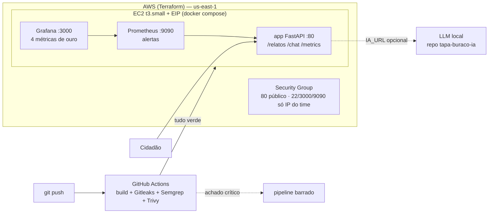

# Tapa Buraco — MVP em Produção (Secure DevOps Tools & Cloud Computing)

Componente de **Produção** da CitizenTech *Tapa Buraco* — Global Solution 2026.2 · FIAP · 4ES.
Deploy Blindado: container, Terraform, pipeline DevSecOps (Gitleaks + Semgrep + Trivy) e
observabilidade com as 4 métricas de ouro.

## Ficha Técnica do MVP

| Campo | Descrição |
|---|---|
| **Nome do produto** | Tapa Buraco |
| **Cidadão e território** | Morador do município de São Paulo que convive com buracos na via, calçadas quebradas e obstáculos — motorista, motociclista, ciclista, pedestre, pessoa com deficiência |
| **Problema, em uma frase** | O cidadão não sabe como reportar um buraco, de quem é a responsabilidade nem como ser ressarcido — e "Buraco e Pavimentação" está entre os temas mais reclamados da Ouvidoria municipal |
| **Proposta de valor** | Em uma tela: reportar o problema com triagem automática (tipo, gravidade, órgão responsável) e tirar dúvidas com um assistente que responde com base em fontes oficiais, citando a fonte |
| **Arquitetura: componentes** | MVP web (FastAPI + SQLite) em container na AWS · IA local (LLM 3B + RAG/agente, repositório `tapa-buraco-ia`) consumida via API · Prometheus + Grafana · pipeline GitHub Actions · infraestrutura Terraform |
| **Fontes de dados** | Base de conhecimento com 36 trechos de fontes oficiais (CTB, CF/88, Lei 15.442/2011, SP156, LGPD) · Dados abertos SP156 (dados.prefeitura.sp.gov.br) |
| **Modelos de IA utilizados** | Qwen2.5-3B-Instruct (GGUF Q4) local via llama.cpp/Vulkan, nas configurações RAG e agente; na nuvem, fallback por regras + busca na mesma base |
| **URL do MVP** | [PREENCHER após o deploy] |
| **Repositórios** | IA: https://github.com/GabrielCatanzaro/tapa-buraco-ia · DevOps: https://github.com/GabrielCatanzaro/tapa-buraco-devops |
| **Indicadores de impacto** | nº de relatos registrados · % de relatos com triagem automática · tempo médio de resposta do assistente · % de perguntas respondidas com fonte citada |
| **ODS conectados** | **11** Cidades e comunidades sustentáveis (vias seguras e zeladoria) · **9** Indústria, inovação e infraestrutura · **3** Saúde e bem-estar (menos acidentes) · **10** Redução das desigualdades (informação de direitos acessível) |

## Arquitetura



## Como reproduzir

### 1. Infraestrutura (AWS Academy Learner Lab)

```bash
cd terraform
cp terraform.tfvars.example terraform.tfvars   # preencha ip_admin com SEU_IP/32
# credenciais: Learner Lab -> AWS Details -> AWS CLI -> cole em ~/.aws/credentials
terraform init
terraform plan
terraform apply
```

Saídas: `url_mvp` (endereço público do MVP) e `comando_ssh`.
O state e o `terraform.tfvars` ficam fora do repositório (`.gitignore`).

### 2. Segredos do pipeline (GitHub → Settings → Secrets → Actions)

| Secret | Valor |
|---|---|
| `AWS_ACCESS_KEY_ID` | Credencial temporária do lab (AWS Details → AWS CLI) |
| `AWS_SECRET_ACCESS_KEY` | Credencial temporária do lab |
| `AWS_SESSION_TOKEN` | Token da sessão do lab (expira junto com a sessão) |
| `EC2_SSH_KEY` | Conteúdo do `labsuser.pem` (vockey, baixada no lab) |
| `GRAFANA_SENHA` | Senha forte para o admin do Grafana |

As credenciais do AWS Academy expiram a cada sessão: ao iniciar uma sessão nova,
atualize os 3 secrets `AWS_*` antes de rodar o pipeline.

### 3. Deploy

`git push` na `main` → o pipeline roda **Gitleaks → Semgrep → build + Trivy** e, se tudo
passar, faz o deploy por SSH (`docker compose up -d --build`). A porta 22 continua fechada
para o mundo: o job localiza a EC2 e o Security Group pela API da AWS, libera o SSH
**só para o IP do runner (/32)** durante o deploy e remove a regra no final, mesmo em caso
de falha. Nenhum segredo no código: tudo em GitHub Secrets e `.env` gerado na hora do deploy.

**Demonstração "execução barrada"**: commite um arquivo com um segredo falso
(ex.: `aws_secret_access_key = "AKIA..."`) → o Gitleaks barra o pipeline; remova e
faça novo push → verde. Prints dos dois no relatório.

### 4. Observabilidade

- **Dashboard**: `http://IP:3000` (admin / `GRAFANA_SENHA`, só do IP do time) — dashboard
  provisionado "Tapa Buraco — 4 métricas de ouro": latência (p50/p95), tráfego (req/s),
  erros (% 5xx) e saturação (CPU/memória).
- **Alerta**: regra `TaxaDeErroAlta` (>5% de 5xx) no Prometheus. Para disparar:
  acesse `http://IP/erro-demo` repetidas vezes e veja FIRING em `http://IP:9090/alerts`.

### 5. Rodar local (desenvolvimento, sem Docker)

```powershell
cd app
pip install -r requirements.txt
# opcional, integra com a IA do repo tapa-buraco-ia rodando na porta 8000:
$env:IA_URL = "http://localhost:8000"
uvicorn main:app --port 8080
```

## Segurança e LGPD

- Dockerfile com **usuário não root**, imagem slim e **sem segredos** (config por ambiente).
- Terraform com **state e tfvars fora do repo**; portas admin **nunca** em 0.0.0.0/0
  (há `validation` que impede).
- Pipeline barra segredo vazado (Gitleaks), código vulnerável (Semgrep) e imagem
  vulnerável (Trivy) **antes** de chegar ao cidadão.
- LGPD: o MVP **não coleta dados pessoais** do cidadão (sem cadastro, sem CPF);
  os relatos têm apenas endereço do problema e descrição; orientação na interface
  para não incluir dados pessoais. Dados ficam no volume `dados` da EC2 (SQLite).

## Integrantes

| Nome | RM |
|---|---|
| Gabriel Gomes Catanzaro | RM93445 |
| Lucas Gomes Alcantara | RM98766 |
| Filipe Prado Menezes | RM98765 |
